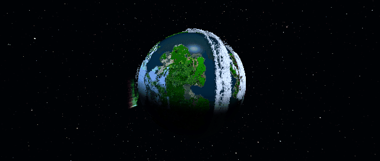
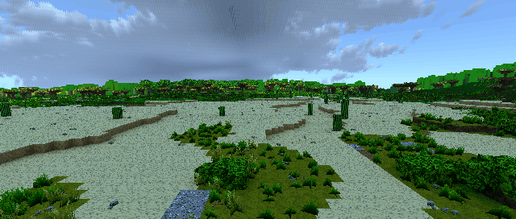
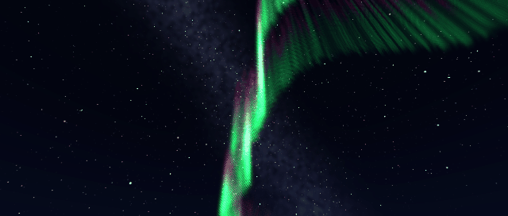
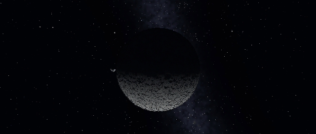
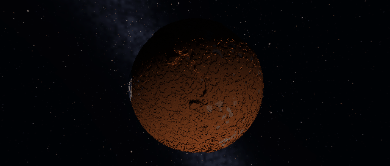
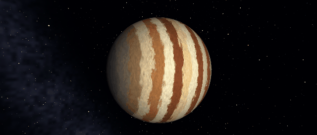
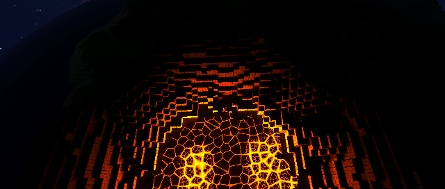
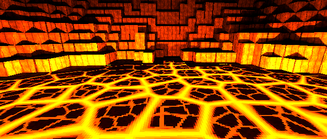

# TechnoApe

A first-person survival and automation game on small spherical planets of 1 m blocks, with a seamless climb
to orbit and on to other worlds. It runs on its own engine, the Pillars of Simulation Engine, written in
Rust + wgpu, and is multiplayer from the first version: singleplayer is a local server.

[](docs/media/technoape-trailer-720p.mp4)

**[Watch the two-minute concept trailer](docs/media/technoape-trailer-720p.mp4)** (720p, 25 MB). It is a
concept cinematic of where the game is headed, not gameplay footage.

## In the game

Recorded from the game itself, as it runs today.

| | |
|:---:|:---:|
|  |  |
| **Terra**, baked from a seed, turning from day into night | **Weather:** clouds and their shadows drifting over a desert |
|  |  |
| **The aurora**, drawn from the planet's magnetic field | **Luna:** craters and maria, turning through her phases |
|  |  |
| **Mars:** rust highlands, canyons and ice caps | **Jupiter**, the banded giant the moons circle |
|  |  |
| **An eruption** at night: the crater's lake, and lava running down the cone | **A lava lake:** a dark crust broken by glowing cracks |

## Status

In development since 2026-10-21, and on its own engine since 2026-11-09 (the first version, a flat world, was
set aside for planets), by one developer working with Claude Code. This is a personal project shown
as it is: there are no releases, the code changes daily, and nothing here is promised to work on your machine.

## Roadmap

The full plan, with dates and the decision behind each step, is in
[`docs/plans/roadmap.md`](docs/plans/roadmap.md). The story is in [`docs/design/lore.md`](docs/design/lore.md).

### Done

| Area | What is built |
|:-----|:--------------|
| **Engine** | Rust + wgpu from scratch · cube-sphere planets of 1 m blocks · streaming and meshing on worker threads · ray-traced light with coloured block light and soft shadows |
| **Terra** | Baked from a seed: plates, mountains, erosion, rivers and lakes, climate, biomes · seasons, weather, tides · plants and herds of animals |
| **Luna** | Craters, maria and polar shadow · highland and mare rock · ilmenite, merrillite and meteoritic iron · lava tubes with skylights |
| **The deep world** | Mantle and liquid metal core · gravity and pressure from each body's mass · rock that forms by pressure and heat, warmer with depth · lava tubes, fissures and karst caves by rock |
| **Volcanoes** | Cones on the plates' arcs, some alive: a chamber held hot, a lava lake, a bare upper cone · eruptions when a chamber bursts its plug, pouring lava that runs down the cone and freezes to basalt |
| **Fluids and heat** | Water, lava and oil as one counted system, lying in layers by density · lava and water react to basalt and steam · ponds freeze from the top, ice melts, water boils by the air's pressure · one rule of heat for all of it · the temperature you feel, from the weather, the depth and the lava in sight |
| **The sky** | Day and night, eclipses, Luna's phases · a magnetic field per body, seen as the aurora · a seamless flight from the ground to orbit and over to Luna |
| **Survival** | Digging along a rock's own cracks · rubble, piles and undercut roofs that fall · inventory, flint tools, first crafting · thirst and breath |
| **Multiplayer** | Authoritative dedicated server · client prediction · scripted bots · recordings that replay to the same state · saves of what changed |
| **Tools** | The Studio for textures, models, effects, sounds and maps · a gate of tests, a 50-bot soak, a speed guard and fixed viewpoints |

### In work

- [ ] **Mars** as a third body: its map is baked (highlands, giant volcanoes, a canyon, dry rivers, ice caps); next it joins the world
- [ ] **The living ground:** ground water with flooded caves and springs · ice and snow in thin layers · gases near the ground and fire that spreads · heat that walls keep in or let out, so a base wants insulation
- [ ] **Speed:** winning back the frame time the deep world and the fluids cost

### To do

- [ ] **Needs and the journal:** health, hunger, death's cost, and a book that fills in as the ape learns by doing
- [ ] **Mining in depth:** blasting, chiselled blocks, collapse, felled trees
- [ ] **Blueprints:** capture a build, name it, paste it, pay its materials from storage
- [ ] **Crafting and the first machines**, then the three networks: shafts, pipes and wires
- [ ] **The climb to orbit by your own means:** the jetpack, rockets, real orbits
- [ ] **Core mining:** draining a planet's liquid core weakens its magnetic field, and the planet pays for it
- [ ] **More bodies:** a gas giant you can dive into, icy moons, other stars

### The ages

The game is played through ages, each ending in a megaproject the player designs:

| Age | The megaproject |
|:----|:----------------|
| **Steam** | One shaft drives a line that turns raw ore into ingots for a full day, untouched |
| **LV** | A steady power grid held through a day and a night |
| **MV** | A railway once around the planet |
| **HV** | A power ring that runs three days without burning fuel |
| **EV** | A satellite in a stable orbit, and the first visit to Luna |
| **IV** | A moon base that keeps an ape alive with nothing delivered |
| **Exotic** | The Ark: a ship that sustains itself and leaves for the next planet |

## Build and run

Windows 11 with a recent discrete GPU is what it is built and measured on. With Rust (stable) installed:

```
cargo build --profile play
target/play/technoape.exe
```

The title menu opens; Singleplayer makes a new universe (the first bake of a planet takes about half a minute).
Keys, chat commands and the arguments that run the game off-screen are in `docs/playing.md`.

`cargo test` runs the logic tests. `bash tools/check.sh fast` is the gate the project holds itself to: tests,
a 50-bot soak and its replay, a speed guard against a frame budget of 8.3 ms, and fixed viewpoints.

## Layout

| Path | Purpose |
|------|---------|
| `crates/engine` | The engine: the world on a cube-sphere grid, the bake, meshing, streaming, the player protocol. No window, no GPU |
| `crates/server` | The authoritative world; the dedicated server binary |
| `crates/client` | Window, renderer, sound, the game itself, benchmark runs |
| `crates/bot` | Windowless scripted players, for tests |
| `crates/studio` | The Studio: the project's own tool for textures, models, effects and maps |
| `data/` | Content as data: blocks, items, rocks, minerals, caves, bodies, creatures, textures |
| `docs/design/vision.md` | What the game is: the ground truth |
| `docs/decisions/` | What has been decided and why, by topic; `INDEX.md` resolves every "ADR NNNN" cited in code |
| `docs/plans/roadmap.md` | What is done and what comes next |
| `CLAUDE.md` | The working agreement between the developer and Claude Code |
| `prototypes/` | Throwaway spikes, each with a README of its question and measured answer |

## How it is made

Most of the code is written by Claude Code under the developer's direction; `CLAUDE.md` is the agreement they
work to. Every change to the engine is read by a reviewer that did not write it, a bug is fixed with a test
seen failing first, and performance is measured, not assumed.

## Licence

No licence is granted. The source is here to be read; all rights are reserved by the author. The trailer page
loads three.js (MIT) and the Syncopate and IBM Plex Mono fonts (SIL Open Font License).
