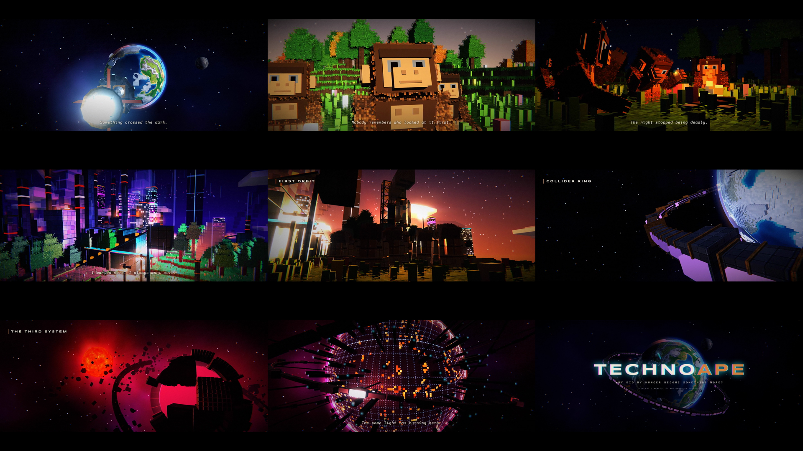

# TechnoApe

A first-person survival and automation game on small spherical planets of 1 m blocks, with a seamless climb
to orbit and on to other worlds. It runs on its own engine, the Pillars of Simulation Engine, written in
Rust + wgpu, and is multiplayer from the first version: singleplayer is a local server.

[](docs/media/technoape-trailer-720p.mp4)

**[Watch the two-minute concept trailer](docs/media/technoape-trailer-720p.mp4)** (720p, 25 MB). It is a
concept cinematic of where the game is headed, not gameplay footage.

## Status

In development since 2026-11-09, by one developer working with Claude Code. This is a personal project shown
as it is: there are no releases, the code changes daily, and nothing here is promised to work on your machine.

What exists today:
- **Planets from a seed.** Terra is baked with plates, erosion, rivers, climate and life; Luna with craters,
  maria and lava tubes. A third body, Mars, has its map and is not in the world yet.
- **A deep world.** A mantle and a liquid metal core under the crust, pressure that decides which rock forms,
  ore placed by the rock it belongs in, and caves by rock: lava tubes, fissures and karst.
- **A living surface.** Weather, seasons, tides, plants and animals; a day and night sky with eclipses and an
  aurora that follows the planet's magnetic field.
- **Survival.** Digging by how rock cracks, an inventory, first tools and crafting.
- **Multiplayer.** An authoritative dedicated server, clients that predict, scripted bots, recordings that
  replay to the same state.

Machines, automation and the journey to orbit come next: `docs/plans/roadmap.md`. The story is in
`docs/design/lore.md`.

## Build and run

Windows 11 with a recent discrete GPU is what it is built and measured on. With Rust (stable) installed:

```
cargo build --profile play
target/play/technoape.exe
```

The title menu opens; Singleplayer makes a new universe (the first bake of a planet takes about half a minute).
Keys, chat commands and the arguments that run the game off-screen are in `docs/playing.md`.

`cargo test` runs the logic tests. `bash tools/check.sh fast` is the gate the project holds itself to: tests,
a 50-bot soak and its replay, a speed guard against a frame budget of 8.3 ms, and fixed viewpoints.

## Layout

| Path | Purpose |
|------|---------|
| `crates/engine` | The engine: the world on a cube-sphere grid, the bake, meshing, streaming, the player protocol. No window, no GPU |
| `crates/server` | The authoritative world; the dedicated server binary |
| `crates/client` | Window, renderer, sound, the game itself, benchmark runs |
| `crates/bot` | Windowless scripted players, for tests |
| `crates/studio` | The Studio: the project's own tool for textures, models, effects and maps |
| `data/` | Content as data: blocks, items, rocks, minerals, caves, bodies, creatures, textures |
| `docs/design/vision.md` | What the game is: the ground truth |
| `docs/decisions/` | What has been decided and why, by topic; `INDEX.md` resolves every "ADR NNNN" cited in code |
| `docs/plans/roadmap.md` | What is done and what comes next |
| `CLAUDE.md` | The working agreement between the developer and Claude Code |
| `prototypes/` | Throwaway spikes, each with a README of its question and measured answer |

## How it is made

Most of the code is written by Claude Code under the developer's direction; `CLAUDE.md` is the agreement they
work to. Every change to the engine is read by a reviewer that did not write it, a bug is fixed with a test
seen failing first, and performance is measured, not assumed.

## Licence

No licence is granted. The source is here to be read; all rights are reserved by the author. The trailer page
loads three.js (MIT) and the Syncopate and IBM Plex Mono fonts (SIL Open Font License).
