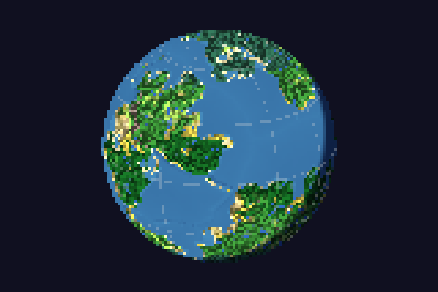
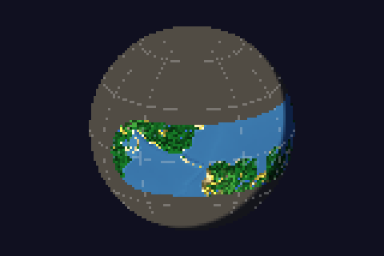
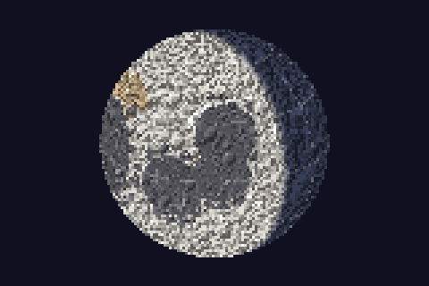

# Globe map spike (W2b, ADR 0077)

**Question.** Where does the globe map's picture come from, how do edits and what the player has explored get
onto it, and what does it cost in VRAM and frame time?

**Run.** `cargo run --release -- <main checkout>/saves/bakes 1337 out` (uses the client's own `globe.rs` and
`nav.rs` by path; the 4 km Terra and its Luna, seed 1337). It prints JSON lines and writes `out/*.png`:
the flat pictures and the globe drawn the way `overlay.wgsl` draws it (same steps on the CPU).

## Answers (measured 2026-11-12, Ryzen 5 5600X, one thread)

| What | Number |
| --- | --- |
| Terra's picture, 1024 x 512 texels (about 24 m at the equator) from 3.5 M map cells | 82-109 ms, once, on a worker |
| Luna's picture, 512 x 256 | 19 ms |
| The whole GPU buffer: head, both pictures, both seen-masks | 2.70 MB |
| Seen-mask on disk per world (Terra 64 KB + Luna 16 KB, raw bits) | 80 KB |
| Marking what is seen, walking (2 m eye, horizon 125 m) | 1 us |
| Marking from a 300 m peak | 72 us |
| Marking from orbit (a hemisphere, 277 k texels) | 0.95 ms (a first texel-by-texel version: 19 ms) |
| Drawing the globe | one UI rectangle; the shader's work, no CPU per frame |

**Where the picture comes from: the bake's map itself (mip 0), resampled once onto latitude and longitude.**
Every texel takes the map cell under its middle (`Grid::locate`): the biome's colour (`life::BIOMES`; Luna's
kinds a grey each), the sea by depth, lakes, and every river cell painted onto the texel it lies in (a river
is narrower than a texel, so sampling alone broke them into dots). Relief is a hillshade from the texels'
heights, lit from the north-west. The mips were not needed: one pass over mip 0 is 0.1 s on a worker. A
cube-map texture of the faces was the other way; a latitude-longitude picture keeps all of the engine's face
conventions on the CPU (`locate`) and makes the shader's lookup one `asin` and one `atan2`.

**Edits do not show** at this scale (a texel is 24 x 24 m on Terra): a "what you built" layer, from the
server's list of edited chunks, is the design's later layer and is left out.

**Explored.** A bit per texel, set around the player out to the horizon from the eye's height over the
ground (`globe::horizon`: about 125 m walking, 2 km from a 300 m peak, a hemisphere from orbit), so climbing
charts more, as the design asks. The first version tested each texel of the rows in reach (19 ms from orbit);
the second takes each row's span from the spherical law of cosines (0.95 ms, the same texels: a test keeps
the slow way as its reference).

**Cost per frame.** The globe is one rectangle of the existing 2D layer; its fragment shader picks the
texel under each 3 x 3 pixel block (the pixel look), darkens the night side from the sun's direction and
shows the unseen bare. The CPU writes the 128-byte view each frame the globe is open and the 64 KB mask when
it changed. Measured in the game: ADR 0077.

**Picked.** As above: the pictures built on a worker when the world loads, one storage buffer (binding 20),
the shader draws, markers are ordinary rectangles.

  
